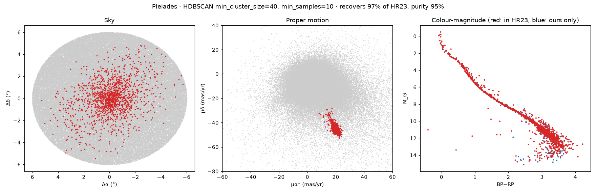
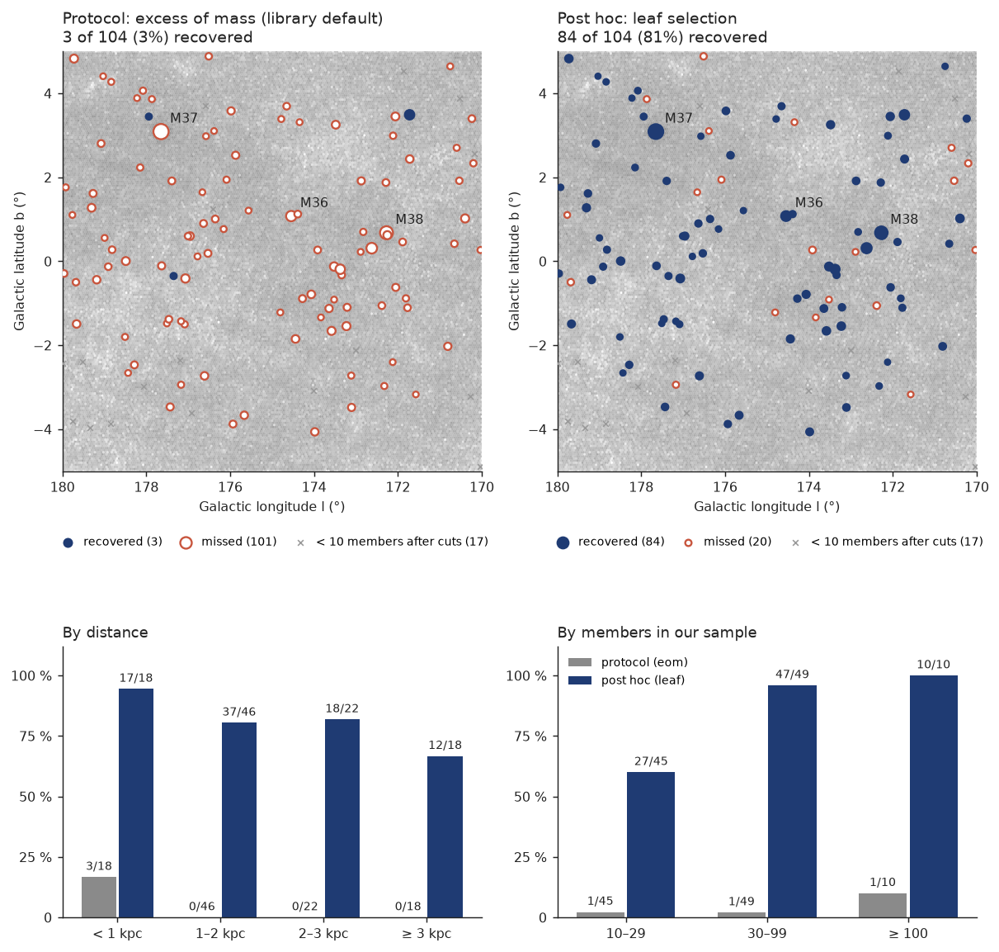
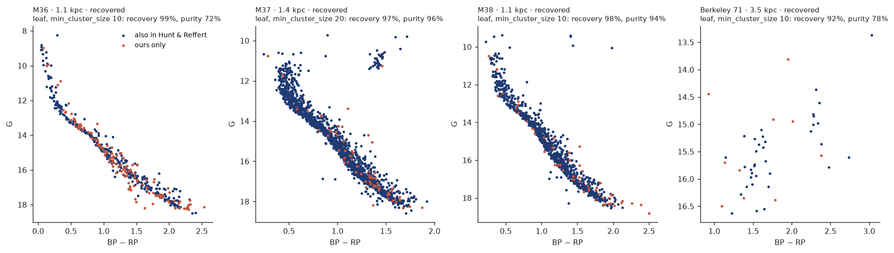
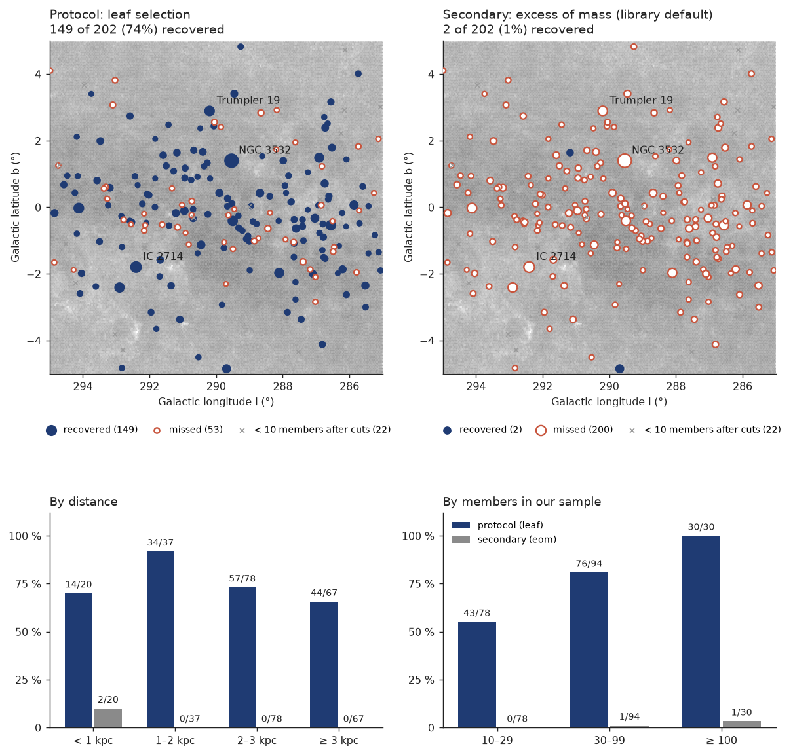
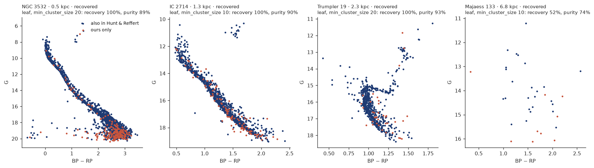
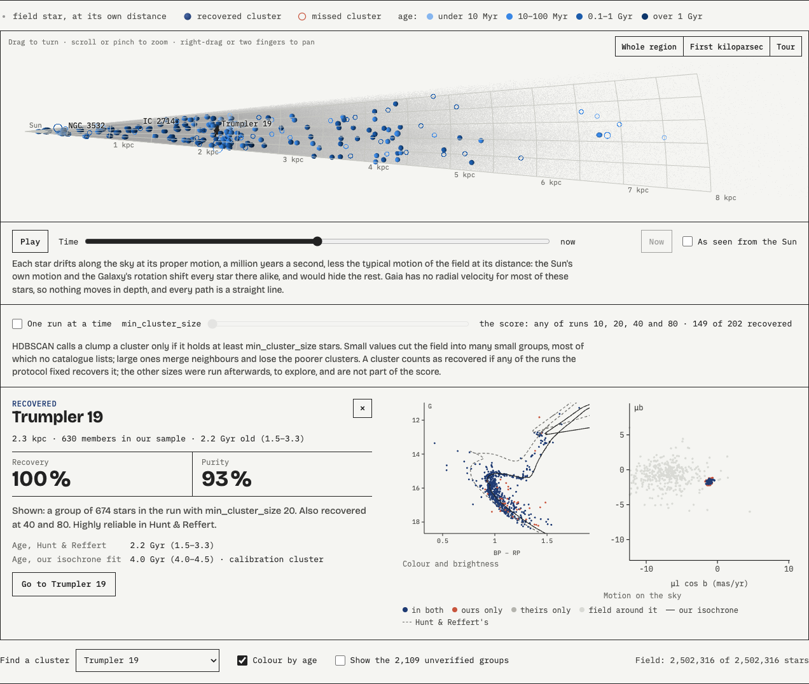

# gaia-clusters

Recover known open star clusters from Gaia DR3 with HDBSCAN, and measure how many come back.

Stars born in the same cloud share position, distance and motion. On the sky they blend into the
field; in five dimensions (position, parallax, proper motion) they form dense clumps. HDBSCAN
finds those clumps without being told how many there are and leaves the field as noise.

This is not a discovery project. [Hunt & Reffert (2023)](https://doi.org/10.1051/0004-6361/202346285)
already ran HDBSCAN over Gaia DR3 and catalogued about 7,000 clusters. Their catalogue is used here
as the reference: the score is the share of their members we recover, and the share of what we
find that they also list.

## First check: the Pleiades

A 6° cone around the Pleiades with parallax > 1 mas, RUWE < 1.4 and parallax/error > 5
(118,080 stars), clustered with `min_cluster_size=40, min_samples=10`, untuned:

| | |
|---|---|
| Clusters found | 2: the field and the Pleiades |
| Pleiades cluster | 1,497 stars |
| Recovery (Hunt & Reffert members passing our cuts that we find) | 96.9 % (1,424 of 1,470) |
| Purity (our members that Hunt & Reffert also list) | 95.1 % |

These numbers come from the `hdbscan` library, which the project uses because it scales to millions
of stars. The first run used scikit-learn's HDBSCAN and gave 96.3 % and 96.3 %.



The Pleiades are the easy case: close, rich and far from the field in proper motion. The number
that matters is the all-sky one, with distant and sparse clusters. Also, this is the same method
on the same data as the reference, so it measures agreement with it, not truth.

## A whole region: Auriga, 10° × 10° of the Galactic plane

Galactic longitude 170–180°, latitude −5° to +5°, towards the Galactic anticentre:
576,442 Gaia DR3 stars with RUWE < 1.4 and parallax/error > 5, and 121 Hunt & Reffert clusters
centred in the box, from 350 pc to 5.4 kpc. 104 of them keep at least 10 members after our cuts;
those are the ones scored. Region, cuts, parameters and matching rule were fixed in
[docs/protocol-auriga.md](docs/protocol-auriga.md) and committed before the first run (`e2a63a1`).

A cluster counts as recovered when one of our groups holds more than half of its members and more
than half of that group are its members. HDBSCAN runs four times, with min_cluster_size 10, 20, 40
and 80 as Hunt & Reffert did, and a cluster recovered by any run counts.

**Under the protocol: 3 of 104 clusters recovered (3 %).** HDBSCAN's default cluster selection,
excess of mass, put most of the field into a single group in every run (545,214 of the 576,442
stars with min_cluster_size 10), and the clusters stayed inside it. The protocol missed that Hunt &
Reffert's first paper ([2021](https://doi.org/10.1051/0004-6361/202039341)), whose parameter
choices the catalogue paper reuses, found leaf selection "almost always superior" to excess of mass
and much better at recovering small clusters, which hold very few stars next to their field.

**Post hoc, switching to leaf selection and changing nothing else: 84 of 104 recovered (81 %)**,
and 62 of the 70 that Hunt & Reffert rate highly reliable (89 %). This number was obtained after
seeing the first one, so a second region with leaf selection fixed in advance had to confirm it:
Carina, below.

| | Protocol (excess of mass) | Post hoc (leaf) |
|---|---|---|
| Under 1 kpc | 3 of 18 | 17 of 18 |
| 1–2 kpc | 0 of 46 | 37 of 46 |
| 2–3 kpc | 0 of 22 | 18 of 22 |
| 3 kpc and beyond | 0 of 18 | 12 of 18 |
| 10–29 members in our sample | 1 of 45 | 27 of 45 |
| 30–99 members | 1 of 49 | 47 of 49 |
| 100 members or more | 1 of 10 | 10 of 10 |



Both expectations written in the protocol hold in the leaf runs: recovery falls with distance
(94, 80, 82 and 67 %, not strictly), and highly reliable clusters come back more often than the rest
(89 % against 65 %). Beyond 3 kpc the cuts weigh as much as the clustering: 13 of the 31 clusters
there keep fewer than 10 members once parallax/error > 5 is applied.

Of the 20 misses, 11 sit inside a bigger group of ours (more than half of their members are there,
but they are less than half of the group), 7 are not found at all (12 members in our sample, median)
and 2 are only partly found. The leaf run with min_cluster_size 10 also finds 494 groups that no
Hunt & Reffert cluster owns. They are not discoveries: Hunt & Reffert discard groups like these with
a significance test and a colour-magnitude classifier, which this project does not have yet.



Full tables in [results/auriga.md](results/auriga.md), one row per cluster in `results/auriga_scores_*.csv`.

## A second region, fixed in advance: Carina

Galactic longitude 285–295°, latitude −5° to +5°, along the Carina arm: 2,521,944 stars after the
same cuts, 4.4 times Auriga's field, and 224 Hunt & Reffert clusters, the most of any 10° window
along the plane. That rule picked the region, from the catalogue alone. 202 of its clusters keep at
least 10 members after our cuts. The protocol, [docs/protocol-carina.md](docs/protocol-carina.md),
is Auriga's with leaf selection instead of excess of mass, and was committed before the first run
(`f8d1d03`).

The protocol also said when Auriga's result would count as replicated. Auriga's leaf rates by
members in our sample (60 % for 10–29, 96 % for 30–99, 100 % for 100 or more), applied to Carina's
clusters, predict 81.5 %, with a 95 % range of 73.3 % to 89.1 %. The bar was the bottom of that
range: at least 148 of the 202.

**Result: 149 of 202 recovered (73.8 %). Auriga's result replicates, with one cluster to spare.**
It lands at the bottom of the predicted range, 8 points under the prediction: the denser field
costs something, and Auriga, with the thinnest field, is the easier case.

| | Auriga, post hoc | Carina, fixed in advance |
|---|---|---|
| Stars after the cuts | 576,442 | 2,521,944 |
| All recoverable | 84 of 104 (81 %) | 149 of 202 (74 %) |
| Highly reliable | 62 of 70 (89 %) | 107 of 132 (81 %) |
| Under 1 kpc | 17 of 18 | 14 of 20 |
| 1–2 kpc | 37 of 46 | 34 of 37 |
| 2–3 kpc | 18 of 22 | 57 of 78 |
| 3 kpc and beyond | 12 of 18 | 44 of 67 |
| 10–29 members in our sample | 27 of 45 (60 %) | 43 of 78 (55 %) |
| 30–99 members | 47 of 49 (96 %) | 76 of 94 (81 %) |
| 100 members or more | 10 of 10 | 30 of 30 |



Against the expectations in the protocol:
- Excess of mass fails again: 2 of 202 (1 %). With min_cluster_size 10 it puts 2,520,594 of the
  2,521,944 stars into one group.
- Highly reliable clusters come back more often than the rest: 81 % against 60 %.
- Recovery does not fall steadily with distance: 70, 92, 73 and 66 %. The nearest bin breaks the
  pattern. Four of its six misses have only 10 to 15 members in our sample, and the other two hold
  most of their members in a group where they fall just short of half (purity 0.48 and 0.49).
- Recovery is lower than Auriga's for clusters with fewer than 100 members in our sample (55 against
  60 %, 81 against 96 %). Those with 100 or more are all recovered in both regions.

Most misses are close calls, and that is where the denser field shows. Post hoc, as a description
and not a new result: in 28 of the 53 misses, the closest run scores above 0.4 on both recovery and
purity, against 6 of 20 in Auriga. In 21 of them it holds most of the cluster's members, but they
are only 40–50 % of the group, which also takes in field stars.

The leaf run with min_cluster_size 10 finds 2,281 groups, and in 2,109 of them no Hunt & Reffert
cluster holds the majority. As in Auriga, they are not discoveries.



The diagrams show the three richest clusters in the reference and the farthest recovered one with
at least 30 members. NGC 3532 even shows its white dwarfs, bottom left, and Trumpler 19 its red
giants. Majaess 133, at 6.8 kpc, draws no clear sequence: Hunt & Reffert's own classifier gives its
diagram 0.04 out of 1. Matching their members is not the same as being a cluster.

Full tables in [results/carina.md](results/carina.md), one row per cluster in `results/carina_scores_*.csv`.

## In three dimensions

The viewer in [viewer/](viewer/) shows both regions in space, seen from above the wedge that each
one fills from the Sun: the field, the recovered clusters and the missed ones. Each cluster has a
card with its distance, recovery, purity and colour-magnitude diagram.



- **Field stars sit at their own distance**, the geometric one of
  [Bailer-Jones et al. (2021)](https://doi.org/10.3847/1538-3881/abd806), not at one over the
  parallax, which is biased when the parallax is uncertain. It comes from the same GAVO service
  (`gedr3dist.litewithdist`), with the polygon and cuts of the star download.
- **The members of a recovered cluster sit at the cluster's distance** in Hunt & Reffert
  (`dist50`), each at its own place on the sky. A member's own distance is uncertain by 87 pc in
  Carina and 85 pc in Auriga (median), while half of a cluster's members sit within 3.2 and 3.6 pc
  of its centre (median `r50pc`). At their own distances, clusters would be needles some 25 times
  longer than wide, pointing at the Sun. The cost: depth is not shown, and seen side-on a cluster is
  flat. So a cluster's members only show when you point at it.
- A cluster is drawn at its catalogue position, as wide as its tidal radius in Hunt & Reffert
  (`rtpc`) and never smaller than a few pixels: a sphere if it was recovered, a ring if it was
  missed. Pointing at a sphere swaps it for the group of the run that recovers it best (highest
  recovery × purity). In the colour-magnitude diagram,
  blue stars are in both our group and Hunt & Reffert, red only in our group and grey only in
  Hunt & Reffert: blue against red is purity, blue against grey is recovery.
- The groups that no Hunt & Reffert cluster owns (2,109 in Carina's min_cluster_size 10 run, 494 in
  Auriga's) stay hidden behind a toggle labelled unverified.
- **Level of detail:** the field is stored in random order and sent in nested levels of 65,536 stars,
  doubling each time, so every level is a uniform sample of the field. The page shows the first at
  once, adds the rest as they arrive (on a phone, up to 524,288 unless asked) and draws fewer while
  the view moves. Like the sky maps above, it shows the field as a density on a log scale.
- **Time:** a slider and a play button move every star along the sky at its proper motion, up to
  5 Myr either way. By default, the field's median motion at the star's distance (in 250 pc bins) is
  taken off: the Sun's own motion and the Galaxy's rotation shift every star at a distance alike, by
  about 6 to 11 mas/yr in Carina against a spread of 1 to 5. A toggle leaves it in. A cluster's
  members keep together while the field around them spreads. Most of these stars have no radial
  velocity in Gaia, so nothing moves in depth, and the paths are straight lines: a picture of the
  motions, not an orbit.

`uv run scripts/export_viewer.py <region>` writes the page's data into `viewer/data/<region>/`
(5.9 MB for Auriga, 25.6 MB for Carina, of which the proper motions, loaded only when time moves, are
2.3 and 10.1 MB) from what the scoring produces, and
`python3 -m http.server -d viewer` serves the page locally.

## Run

```bash
uv sync
uv run pytest
uv run scripts/pleiades.py              # downloads into data/ on first run (~15 min from VizieR)
uv run scripts/fetch_region.py auriga   # stars and distances from GAVO, Hunt & Reffert members from VizieR
uv run scripts/score_region.py auriga   # HDBSCAN runs, scores, figures (same for carina)
uv run scripts/export_viewer.py auriga  # the viewer's data
```
